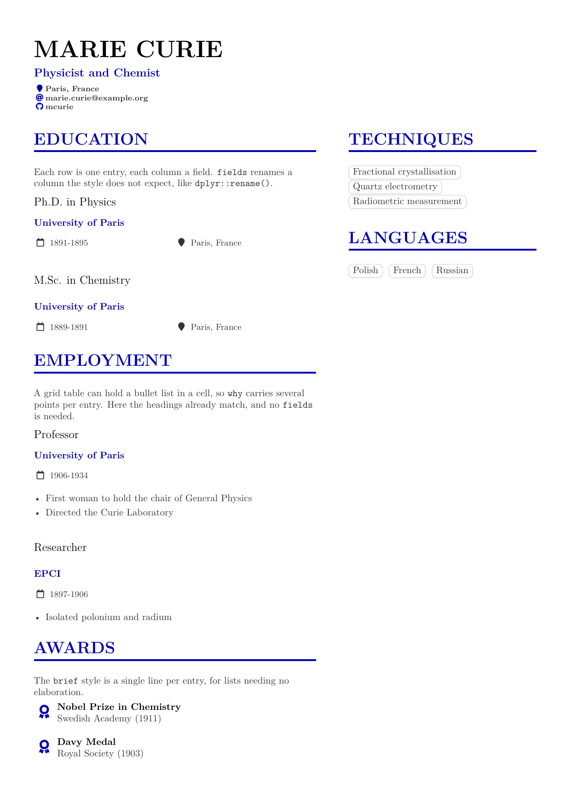

# AltaCV

A Quarto format for writing a CV with
[AltaCV](https://github.com/liantze/AltaCV), a two-colour, icon-driven LaTeX
class by LianTze Lim, described upstream as the most-starred LaTeX CV class on
GitHub. CV entries are written as tables, either by hand or generated by code.

<table>
<tr>
<td width="320"></td>
<td><code>format: altacv-pdf</code><br>Two asymmetric columns: a main column built from headings and <code>.entries</code> tables in the <code>detailed</code>, <code>brief</code> and <code>skills</code> styles, and a side column of tagged skill groups filled from <code>sidebar:</code> front matter.</td>
</tr>
</table>

## Installing

```bash
quarto use template quarto-vitae/altacv
```

This installs the extension and creates a starting `template.qmd`. To add the
format to a document you already have, use `quarto add quarto-vitae/altacv`.

Rendering needs a LaTeX installation with **xelatex** (or lualatex), since the
class loads `fontspec` and `fontawesome5`. If you have no LaTeX,
`quarto install tinytex` will do; the packages are fetched on the first
render.

## Using

Set the format and describe yourself in the YAML header:

```yaml
---
name: Marie
surname: Curie
position: "Physicist and Chemist"
address: "Paris, France"
email: "marie.curie@example.org"
github: mcurie
format: altacv-pdf
---
```

Write each section as a heading, and each listing as a table inside an
`.entries` div. One row becomes one entry, and one column becomes one field on
it, named by its heading:

```markdown
# Education

::: {.entries style="detailed"}
| what             | with                | when      | where         |
|------------------|---------------------|-----------|---------------|
| Ph.D. in Physics | University of Paris | 1891-1895 | Paris, France |
:::
```

Where your data uses different headings, rename them with `fields`, written
`new: old` in the manner of `dplyr::rename()`.

Markdown inside table cells is preserved, so `**bold**`, `*italic*` and links
all work. LaTeX special characters are escaped for you exactly once, so a
literal `100%` needs no backslash.

### Entries from code

More often the data lives in a data frame, and the same options are given as
cell options. The cell prints a table and the filter picks it up:

````markdown
```{r}
#| echo: false
#| vitae:
#|   style: detailed
#|   fields:
#|     what: degree
#|     with: institution
#|     when: years
education |> filter(completed)
```
````

Entries can also come from a CSV printed by a cell, from several tables in one
div, or carry bullet lists written in grid table cells. Those are covered in
the [vitae documentation](https://quarto-vitae.github.io/).

## The two columns

Upstream leaves it to the author to decide what goes in which of AltaCV's two
columns. This template settles that the same way the `sidebar` designs in
[latexcv](https://github.com/quarto-vitae/latexcv) do: the ordinary body of
the document — headings and `.entries` divs — fills the main (left) column,
and a `sidebar:` list in the front matter fills the side (right) one:

```yaml
sidebar:
  - title: Techniques
    items:
      - Fractional crystallisation
      - Quartz electrometry
  - title: Languages
    items:
      - Polish
      - French
```

Each section becomes a heading over a run of pill-shaped tags, one per item.
`main-ratio` sets how the page is split between the two columns (default
`0.6`, favouring the main column).

## Styles

This format implements the three conventional vitae listing styles, mapped
onto AltaCV's own macros.

`detailed`
: One `\cvevent`, using `what`, `with`, `when` and `where`, with a bulleted
  elaboration built from `why`. Suits education and employment. This is the
  style used when none is given.

`brief`
: A single line per entry, drawn with `\cvachievement` under a fixed award
  icon: `what` as the header, and `where` (falling back to `with`) plus
  `when` in parentheses as the description. Suits awards and memberships.

`skills`
: A category in `what`, with its members in `with` (or `why`, if given as a
  list) rendered as pill tags underneath — AltaCV's own `\cvskill` expects a
  numeric 1–5 rating rather than a list of members, so tags are the closer
  fit for the conventional shape.

## Format options

Set these in the YAML header. All are optional except `name`.

### Header contents

| Option | Effect |
|--------|--------|
| `name`, `surname` | The name shown in the header |
| `position` | The tagline under the name |
| `address` | Shown as the location in the personal info line |
| `phone`, `email`, `www` | Contact details |
| `github`, `linkedin`, `orcid` | Profile links |
| `profilepic` | Path to a profile image, cropped to a circle unless `normalphoto` is set as a `classoption` |
| `profilepic-width` | Diameter of the profile image, defaulting to `2.8cm` |

### Appearance

| Option | Effect |
|--------|--------|
| `sectcol` | Accent colour as a hex string, such as `"8F0D0D"`. `headcolor` is accepted as an alias. Defaults to AltaCV's own blue. |
| `main-ratio` | Width of the main column as a fraction of the page, defaulting to `0.6` |
| `fontsize` | Base font size, defaulting to `10pt` |
| `papersize` | Paper size, defaulting to `a4`. Use `letter` for US letter |
| `geometry` | Page margins and column separation, passed to the `geometry` package |
| `classoption` | Extra class options, such as `[normalphoto]` or `[ragged2e]` |

### Typography

AltaCV uses whatever `fontspec` falls back to by default. Any font installed
on your system can be used instead:

```yaml
mainfont: "TeX Gyre Pagella"
```

| Option | Effect |
|--------|--------|
| `mainfont` | Body font |
| `mainfontoptions` | Font features passed to `fontspec`, such as `Numbers=OldStyle` |

## Licensing

This template redistributes AltaCV's own `altacv.cls`, unmodified, under its
existing LPPL 1.3+ licence. Everything else here is released under CC BY-SA
4.0, see [LICENSE](LICENSE.md). Built on
[AltaCV](https://github.com/liantze/AltaCV) by LianTze Lim.

---

> [!TIP]
> **This is one of several vitae templates for Quarto.**
>
> They share the same entry syntax, so a CV written here can be rendered with
> a different design by changing the `format:` line. To browse the other
> templates, read the full guide to writing a CV, or build a template of your
> own, visit <https://quarto-vitae.github.io/>.
